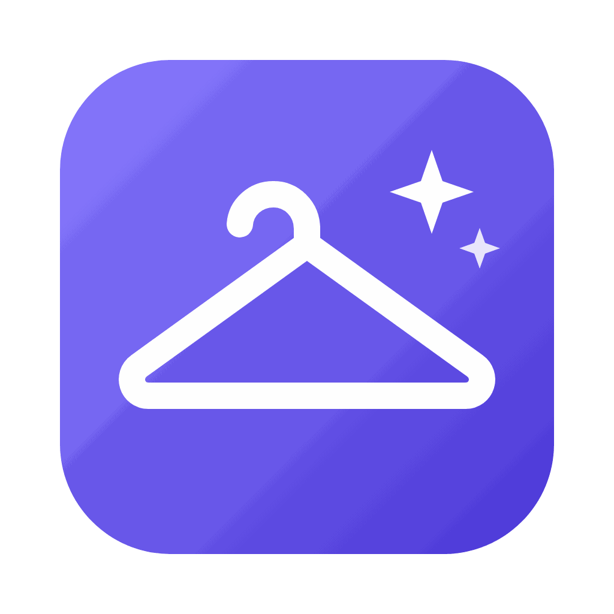

<p align="center">
  
</p>

<h1 align="center">Probador Virtual</h1>

<p align="center">
  Arrastra cualquier prenda desde una tienda online y pruébatela <b>en vivo con tu cámara</b>.<br/>
  App de escritorio para macOS y Windows, con la IA de prueba virtual en tiempo real de <a href="https://platform.decart.ai">Decart</a>.
</p>

<!-- Agrega aquí una captura o un GIF de la app funcionando, por ejemplo:  -->

## ✨ Qué hace

- Abre una **ventana flotante** que se queda encima de tu navegador.
- **Arrastra la foto de una prenda** desde cualquier web (también puedes pegarla con ⌘V / Ctrl+V o elegir un archivo).
- Presiona **Probar** y te ves con la prenda puesta, en vivo, siguiendo tus movimientos.
- Cambia de prenda sin reconectar; las miniaturas guardan las últimas que probaste.
- Modo **cámara grande** (⤢) para que el video ocupe toda la ventana.

## ⬇️ Descargar

Ve a **[Releases](../../releases/latest)** y descarga el archivo para tu computador:

| Sistema | Archivo |
| --- | --- |
| Mac con chip Apple (M1, M2, M3, M4…) | `Probador-Virtual-x.y.z-mac-arm64.dmg` |
| Mac con procesador Intel | `Probador-Virtual-x.y.z-mac-x64.dmg` |
| Windows 10 / 11 | `Probador-Virtual-Setup-x.y.z.exe` |

> ¿No sabes qué Mac tienes? Menú  → **Acerca de este Mac**. Si dice "Chip Apple", usa `arm64`; si dice "Intel", usa `x64`.

### Primera vez en Mac

La app no está firmada con un certificado de Apple de pago, así que macOS la bloquea la primera vez:

1. Abre el `.dmg` y arrastra **Probador Virtual** a **Aplicaciones**.
2. Ábrela. Aparecerá un aviso de que no se puede verificar: presiona **OK / Listo**.
3. Ve a **Ajustes del Sistema → Privacidad y seguridad**, baja hasta el final y presiona el botón para abrirla igualmente (**Open Anyway**). Confirma con tu contraseña.
4. Acepta el permiso de **cámara** cuando lo pida.

<details>
<summary>Alternativa con la Terminal</summary>

```bash
xattr -dr com.apple.quarantine "/Applications/Probador Virtual.app"
```
</details>

### Primera vez en Windows

Windows SmartScreen puede mostrar "Windows protegió tu PC" porque la app no está firmada. Presiona **Más información → Ejecutar de todas formas** e instala normalmente.

## 🔑 Tu clave de Decart (gratis para empezar)

La IA corre en los servidores de Decart, así que cada persona usa **su propia clave**:

1. Crea una cuenta en **[platform.decart.ai](https://platform.decart.ai)**. Las cuentas nuevas reciben **créditos gratis** para probar.
2. Crea una **API key** en el panel.
3. En la app, abre **⚙︎ Ajustes**, pega la clave y guarda.

**Costo:** el modelo cobra aproximadamente **US$0,02 por segundo** mientras está activo (punto verde 🟢). Una prueba de 30 segundos cuesta ~US$0,60 en créditos. **Sin tarjeta registrada no se te cobra nada**: cuando se acaban los créditos gratis la app te avisa y deja de generar. Precios actualizados en la [documentación de Decart](https://docs.platform.decart.ai/getting-started/pricing).

Consejos para que rindan los créditos:
- Presiona **Detener** apenas veas la prenda.
- En ⚙︎ puedes hacer que se detenga sola tras 1 minuto sin cambiar de prenda.

## 👕 Cómo usarla

1. Abre una tienda o Pinterest en tu navegador.
2. Arrastra **la foto de la prenda** (no el título ni el enlace) a la ventana.
3. (Opcional) Elige el tipo de prenda o escribe una descripción corta en inglés, por ejemplo `blue leather bomber jacket`.
4. Presiona **Probar**. En unos segundos el punto se pone verde 🟢 y verás la prenda puesta.

Funciona mejor con fotos de **la prenda sola sobre fondo liso**. Si arrastras una miniatura muy pequeña, la app te pedirá la foto en grande.

## 🔒 Privacidad

- Mientras una sesión está activa, el **video de tu cámara se envía a Decart** para generar el resultado. Revisa su [política de privacidad](https://docs.platform.decart.ai/resources/privacy-policy).
- Tu clave se guarda **cifrada en tu computador** (llavero del sistema) y la ventana nunca la ve: la app usa tokens temporales de 5 minutos.
- La app no tiene analítica ni envía datos a ningún otro servidor.

## 🛠️ Para desarrolladores

Requisitos: Node.js 22.23.4+ (o 24.22.1+).

```bash
npm install
npm start          # app de escritorio en modo desarrollo (muestra diagnóstico en la Terminal)
npm run web        # misma interfaz en Chrome, con ventana flotante Picture-in-Picture
npm run dist:mac   # genera el .dmg en release/ (solo en macOS)
npm run dist:win   # genera el .exe en release/ (en Windows)
```

| Archivo | Qué hace |
| --- | --- |
| `main.js` | Ventana flotante, permisos de cámara, clave cifrada, tokens temporales, descarga de imágenes. |
| `preload.js` | Puente seguro entre la ventana y el proceso principal. |
| `src/renderer.js` | Cámara, arrastrar/pegar, normalización de imágenes y sesión WebRTC con Decart. |
| `scripts/patch-sdk.js` | Ajustes al SDK de Decart para que funcione empaquetado (ver abajo). |
| `server.js`, `web-shim.js` | Modo navegador (`npm run web`). |

**Sobre `scripts/patch-sdk.js`:** se ejecuta solo antes de cada compilación y hace dos cosas: desactiva un diagnóstico de latencia del SDK que depende de un Web Worker que no viaja dentro del bundle (sin el parche, los cuadros de la cámara se pierden y se envían 0 bytes), y quita el parámetro `x-google-start-bitrate` que el SDK y LiveKit agregan a la negociación WebRTC y que Chromium rechaza. La versión del SDK está fijada (`@decartai/sdk` 0.2.14) porque el parche depende de su código interno.

Para ver el diagnóstico en la app instalada: `PROBADOR_DEBUG=1 "/Applications/Probador Virtual.app/Contents/MacOS/Probador Virtual"`.

### Publicar una versión

1. Sube los cambios a GitHub.
2. En **Releases → Draft a new release**, crea una etiqueta nueva (por ejemplo `v1.0.0`) y presiona **Publish release**.
3. GitHub Actions compila el `.dmg` (Apple y Intel) y el `.exe` y los adjunta a la release en unos 10 minutos (pestaña **Actions** para ver el progreso).

Antes de cada versión, actualiza `"version"` en `package.json` para que coincida con la etiqueta.

## ⚖️ Aviso

Proyecto independiente, sin afiliación con Decart. Usa el SDK público [`@decartai/sdk`](https://www.npmjs.com/package/@decartai/sdk) y requiere una cuenta propia de Decart; su uso está sujeto a sus [términos](https://docs.platform.decart.ai/resources/terms-of-service) y [política de uso aceptable](https://docs.platform.decart.ai/resources/aup). Las imágenes de prendas pertenecen a sus respectivas tiendas: úsalas solo para probártelas.

## 📄 Licencia

[MIT](LICENSE)
